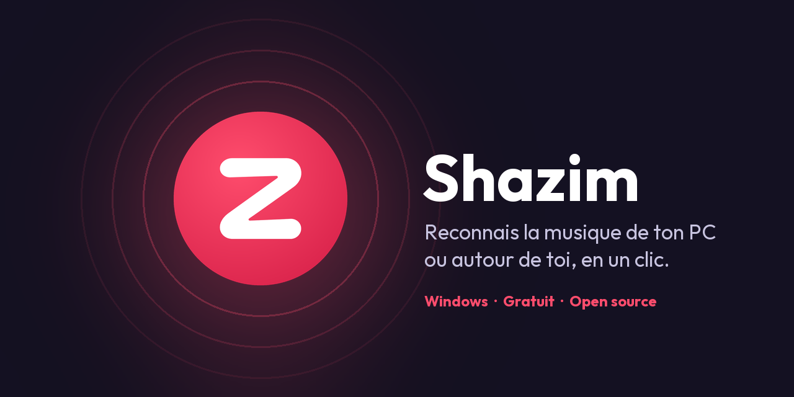
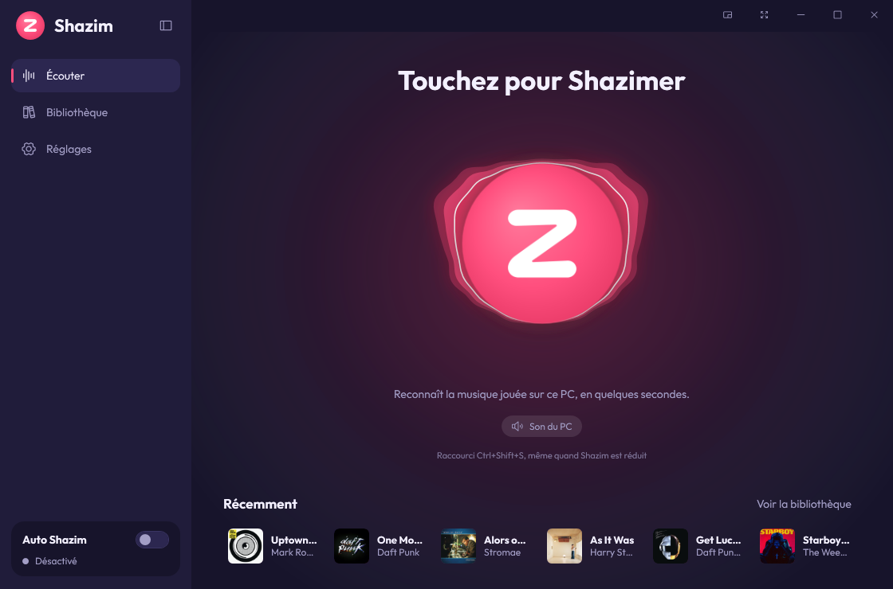
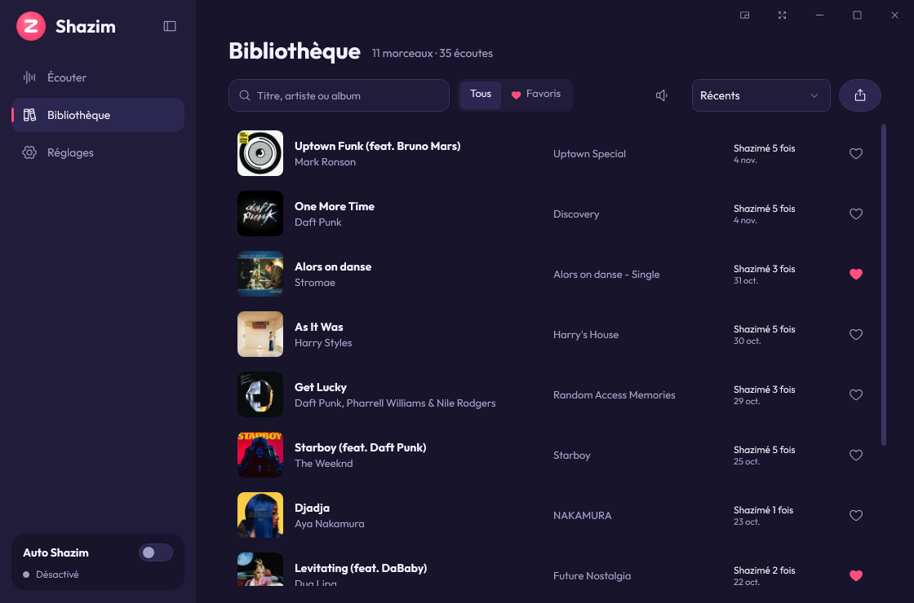
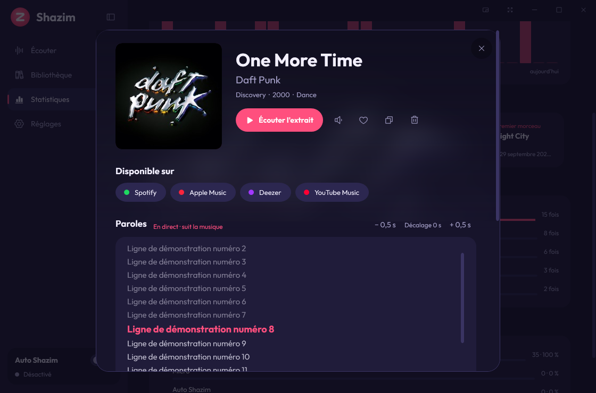
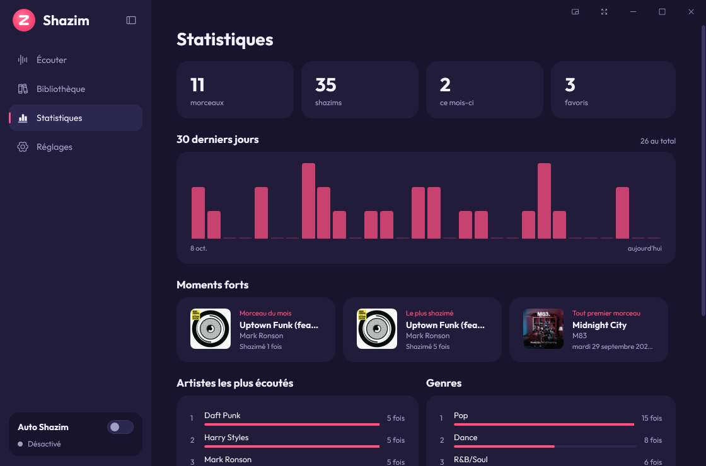
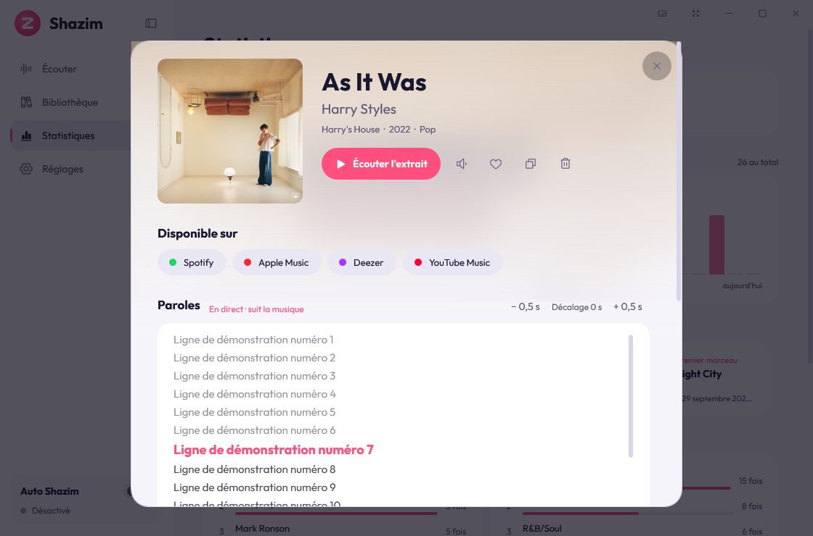
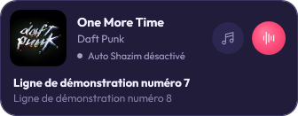
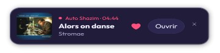
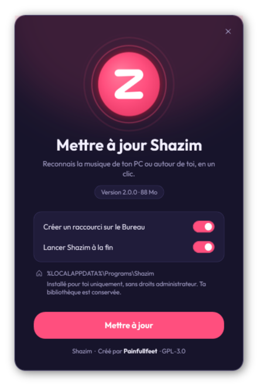

<div align="center">



# Shazim

**Erkenne die Musik auf deinem PC oder um dich herum – mit einem Klick.**<br>
Kostenlose Open-Source-App für Windows, die jeden Song erkennt: YouTube-Video, Twitch-Stream, Spiel, Discord, Film, Radio… oder die Musik im Raum über dein Mikrofon.

[](https://github.com/painfullfeet/Shazim/releases/latest)
[](https://github.com/painfullfeet/Shazim/releases)


[](LICENSE)


[Français](README.md) · [English](README.en.md) · [Español](README.es.md) · **Deutsch**

</div>

---

<p align="center">
  
  
</p>

## Warum Shazim?

Am Handy öffnet man einfach Shazam. Am PC ist das schwieriger: Die Musik läuft im Kopfhörer, das Handy hört sie nicht.
**Shazim hört direkt den Ton deines Computers** (ohne Mikrofon, ohne Kabel) und nennt dir den Titel in Sekunden.
Es kann auch das Mikrofon nutzen, um die Musik im Raum zu erkennen – oder beides gleichzeitig.

- ✅ Kostenlos, ohne Werbung, ohne Konto, ohne API-Schlüssel
- ✅ Installation mit einem Klick, **ohne Administratorrechte**
- ✅ Audio verlässt nie deinen PC: Es wird nur ein Fingerabdruck gesendet
- ✅ Dunkle, animierte Oberfläche, 5 Farben, 4 Sprachen

## Funktionen

| | |
|---|---|
| 🎧 **PC-Ton, Mikrofon oder beides** | Erfasst, was du hörst (WASAPI-Loopback), das Mikrofon (auch Headset) oder beides parallel. |
| ⚡ **Schnell** | Die Suche beginnt nach 4 s und läuft weiter (8 s, 12 s), bis etwas gefunden wird. |
| 💿 **Vollständige Titelseite** | Cover, Album, Jahr, Genre, Label, 30-s-Hörprobe, Plattformen (Spotify, Apple Music, Deezer, YouTube Music), Anzahl der Erkennungen und Verlauf. |
| 📚 **Bibliothek** | Alle Titel, Suche, Favoriten, Sortierung, Hörproben in der Liste, Export als CSV oder JSON. |
| 🔁 **Auto Shazim** | Hört im Hintergrund durchgehend zu und speichert jeden neuen Titel. |
| 🌊 **Lebendige Taste** | Die Hör-Taste reagiert auf die Musik: Aura wie ein Visualizer oder Logo-Puls im Takt. |
| 🎨 **Designs und Farben** | 4 Designs (*Nacht*, *Mitternacht* reines Schwarz für OLED, *Hell*, *Wie Windows*), 5 Akzentfarben oder deine eigene (Farbton + Hex-Code). |
| 🎤 **Synchronisierte Songtexte** | Karaoke-Stil auf der Titelseite: Die gesungene Zeile leuchtet und scrollt von selbst, mit ±-Korrektur. Quelle: [LRCLIB](https://lrclib.net). |
| 🪟 **Kompaktes Widget** | Kleine, immer sichtbare Karte: Cover, Titel, Künstler, Auto Shazim, Shazim-Taste und die aktuelle Textzeile. |
| 📊 **Statistik** | Titel und Shazims, 30-Tage-Diagramm, Titel des Monats, am häufigsten geshazimt, erster Titel, Top-Künstler und Genres, PC / Mikro / Auto. |
| 🔔 **Shazim-Pop-up** | Findet Auto Shazim einen Titel, erscheint eine kleine Karte über der Taskleiste, ohne den Fokus zu stehlen. Oder eine Windows-Benachrichtigung, mit oder ohne Ton. |
| ⬆️ **Eingebaute Updates** | Shazim prüft einmal am Tag GitHub, lädt die neue Version, prüft ihre SHA-256-Summe und installiert sie selbst. |
| 🌍 **4 Sprachen** | Français, English, Español, Deutsch – sofort umschaltbar. |

### Neu in Version 2.1

<p align="center">
  
  
</p>
<p align="center">
  
  
  
</p>

## Installation

1. Öffne **[Releases](https://github.com/painfullfeet/Shazim/releases/latest)** und lade `Shazim-Setup-x.y.z.exe` herunter (ca. 230 MB, .NET enthalten).
2. Doppelklicke die Datei, wähle deine Optionen und klicke auf **Installieren**.

<p align="center">
  
</p>

> [!NOTE]
> **Windows zeigt „Der Computer wurde durch Windows geschützt“?** Das ist bei kostenloser Software ohne kostenpflichtiges Signaturzertifikat normal.
> Klicke auf **Weitere Informationen** und dann **Trotzdem ausführen**. Der Quellcode ist öffentlich, und du kannst die Datei mit der SHA-256-Prüfsumme der Release prüfen.

Shazim wird **nur für dein Windows-Konto** in `%LOCALAPPDATA%\Programs\Shazim` installiert.
**Aktualisieren**: neue Version starten, deine Bibliothek bleibt erhalten.
**Deinstallieren**: Windows-Einstellungen → Apps → Installierte Apps → Shazim.

## Kurzanleitung

1. Spiele Musik ab (Video, Spiel, Stream, Spotify…).
2. Tippe in Shazim auf die **große Taste** im Bildschirm *Hören* (oder drücke `Leertaste`).
3. Nach wenigen Sekunden erscheint die Titelseite, der Titel ist in deiner Bibliothek gespeichert.

Auch wenn Shazim minimiert ist: **`Strg+Umschalt+S`** in jeder App.

- **Quelle**: *PC-Ton*, *Mikrofon* oder *Beides* (unter der Taste oder in den **Einstellungen**). **Testen** prüft, ob Ton ankommt.
- **Bibliothek**: Klick auf einen Titel öffnet die Details; ▶ spielt die Hörprobe; ❤ für Favoriten; Export als CSV oder JSON.
- **Auto Shazim** (`Strg+Umschalt+A`): Dauerbetrieb, Duplikate werden eine einstellbare Zeit ignoriert.
- **Einstellungen**: Sprache, Tasten-Effekt (*Aura*, *Puls*, *Keiner*), Farbe, Autostart, Kürzel, Benachrichtigungen.

| Kürzel | Aktion |
|---|---|
| `Strg+Umschalt+S` | Shazimen (überall in Windows) |
| `Strg+Umschalt+A` | Auto Shazim ein / aus |
| `Strg+1` · `Strg+2` · `Strg+3` | Hören · Bibliothek · Einstellungen |
| `Strg+B` · `F11` | Seitenleiste · Vollbild |

## Datenschutz

Audio wird **nur im Speicher** gehalten und danach gelöscht: Nichts wird auf die Festplatte geschrieben. Gesendet wird nur ein auf deinem PC berechneter **spektraler Fingerabdruck**, nie der Ton. Kein Konto, keine Werbung, keine Statistiken. Deine Daten liegen in `%LOCALAPPDATA%\Shazim`. Songtexte werden bei [LRCLIB](https://lrclib.net) nur mit Künstler, Titel, Album und Länge abgefragt; die Update-Prüfung fragt GitHub, ohne Persönliches zu senden. Beides lässt sich abschalten. **Keine Standortdaten**: Es wird immer eine feste, allgemeine Position gesendet, nie deine. **Updates sind signiert** (siehe [SECURITY.md](SECURITY.md)).

## Häufige Fragen

- **„Kein Ton erkannt“**: Prüfe, ob die Musik läuft, wähle in den Einstellungen die richtige **Audioausgabe** und klicke auf **Testen**.
- **„Titel nicht gefunden“**: Versuche es beim Refrain oder einer markanteren Stelle.
- **Brauche ich ein Konto oder einen API-Schlüssel?** Nein.
- **Funktioniert es offline?** Nein, die Erkennung braucht Internet.

## Aus dem Quellcode bauen

Voraussetzungen: Windows 10/11 und das [.NET 10 SDK](https://dotnet.microsoft.com/download/dotnet/10.0).

```powershell
git clone https://github.com/painfullfeet/Shazim.git
cd Shazim
./run.ps1          # bauen und starten
./release.ps1      # erstellt dist\Shazim-Setup-<Version>.exe
```

## Credits und Lizenzen

Erstellt von **Painfullfeet**, mit Hilfe von **[Claude](https://claude.ai)**, dem KI-Assistenten von Anthropic.

Signatur-Algorithmus: Portierung von [SongRec](https://github.com/marin-m/SongRec) (GPL-3.0) · Audio: [NAudio](https://github.com/naudio/NAudio) (MIT) · Schrift: [Outfit](https://github.com/Outfitio/Outfit-Fonts) (SIL OFL) · Icons: [Phosphor](https://phosphoricons.com) (MIT). · Songtexte: [LRCLIB](https://lrclib.net)

Shazim ist freie Software unter der **[GNU GPL v3](LICENSE)**.

> [!IMPORTANT]
> Shazim ist ein unabhängiges privates Projekt und **weder mit Shazam noch mit Apple Inc. verbunden oder von ihnen unterstützt.** „Shazam“ ist eine Marke von Apple Inc. Shazim nutzt einen nicht dokumentierten Erkennungsdienst, der sich jederzeit ändern oder eingestellt werden kann.

<div align="center">
<sub>Stichwörter: Musikerkennung PC · Song erkennen Windows · Shazam für PC · welcher Song ist das · Audio-Fingerprinting</sub>
</div>
