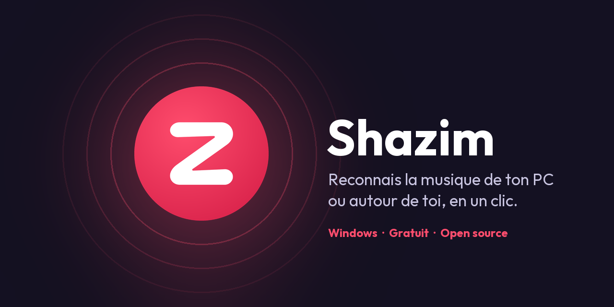
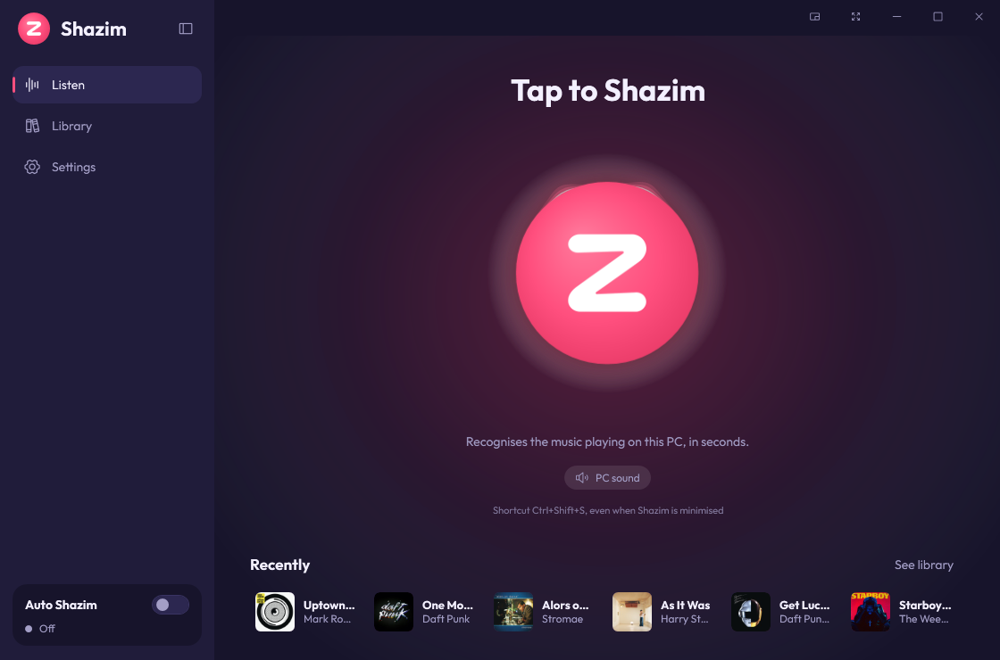
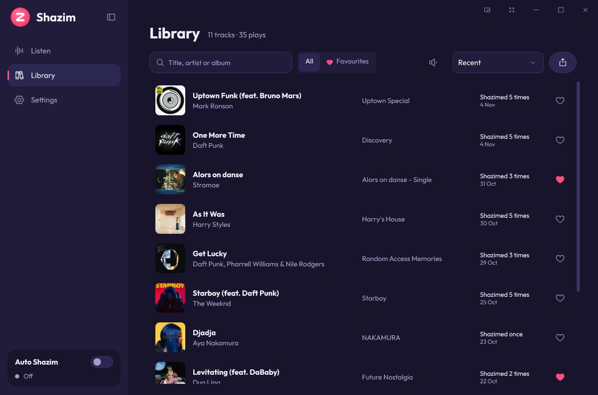
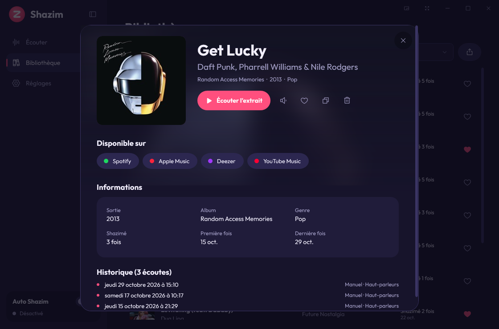
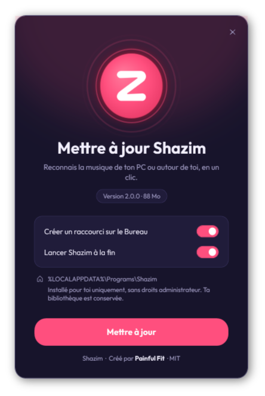
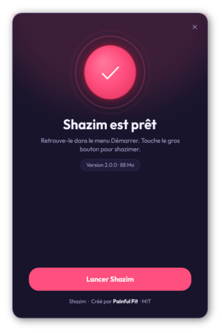

<div align="center">



# Shazim

**Recognise the music playing on your PC or around you, in one click.**<br>
A free, open-source Windows app to identify any song: YouTube video, Twitch stream, game, Discord, movie, radio… or the music in the room through your microphone.

[](https://github.com/painfullfeet/Shazim/releases/latest)
[](https://github.com/painfullfeet/Shazim/releases)


[](LICENSE)


[Français](README.md) · **English** · [Español](README.es.md) · [Deutsch](README.de.md)

</div>

---

<p align="center">
  
  
</p>

## Contents

- [Why Shazim?](#why-shazim)
- [Features](#features)
- [Installation](#installation)
- [User guide](#user-guide)
- [Keyboard shortcuts](#keyboard-shortcuts)
- [Privacy](#privacy)
- [FAQ](#faq)
- [Build from source](#build-from-source)
- [Credits and licences](#credits-and-licences)

## Why Shazim?

On a phone you just open Shazam. On a PC it is harder: the music plays in your headphones and your phone cannot hear it.
**Shazim listens to your computer's sound directly** (no microphone, no cable) and gives you the title in seconds.
It can also use your microphone to recognise the music in the room, or both at the same time.

- ✅ Free, no ads, no account, no API key
- ✅ One-click install, **no admin rights needed**
- ✅ Audio never leaves your PC: only a fingerprint is sent
- ✅ Dark animated interface, 5 colours, 4 languages

## Features

| | |
|---|---|
| 🎧 **PC sound, microphone or both** | Captures what you hear (WASAPI loopback), the microphone (headset included) or both in parallel: the first source that recognises the track wins. |
| ⚡ **Fast** | Searching starts after 4 s of listening and goes on (8 s, 12 s) until something is found. |
| 💿 **Full track page** | Artwork, album, year, genre, label, 30 s preview, where to listen (Spotify, Apple Music, Deezer, YouTube Music), how many times you shazimed it and history. |
| 📚 **Library** | All your tracks, search, favourites, sorting, previews right in the list, CSV or JSON export. |
| 🔁 **Auto Shazim** | Listens non-stop in the background and saves every new track (great for a playlist, a live set or a mix). |
| 🌊 **Living button** | The listen button reacts to the music: a visualiser-style aura or a logo pulse on the beat. |
| 🎨 **Customisable** | 5 accent colours, collapsible sidebar, full screen, floating mini player. |
| 🔔 **Always there** | Notification-area icon, Windows notifications, global shortcuts, start with Windows. |
| 🌍 **4 languages** | Français, English, Español, Deutsch — switch instantly, no restart. |

<p align="center">
  
</p>

## Installation

### 1. Download

Open the **[Releases](https://github.com/painfullfeet/Shazim/releases/latest)** page and download `Shazim-Setup-x.y.z.exe` (about 90 MB, nothing else to install: .NET is included).

### 2. Run the installer

Double-click the downloaded file, pick your options and click **Install**.

<p align="center">
  
  &nbsp;&nbsp;
  
</p>

> [!NOTE]
> **Windows says "Windows protected your PC"?** That is normal for free software without a paid code-signing certificate.
> Click **More info** then **Run anyway**. The source code is fully public here, and you can check the file against the SHA-256 checksum published with the release.

Shazim installs **for your Windows account only**, in `%LOCALAPPDATA%\Programs\Shazim`, with a Start menu shortcut (and a desktop one if you want).

### Update

Download the new version and run it: it replaces the old one. **Your library and settings are kept.**

### Uninstall

**Windows Settings → Apps → Installed apps → Shazim → Uninstall.** You can keep or delete your library.

## User guide

### Identify a track

1. Play the music (video, game, stream, Spotify…).
2. In Shazim, tap the **big button** on the *Listen* screen (or press `Space`).
3. A few seconds later the track page opens. The track is added to your library automatically.

Even when Shazim is minimised, press **`Ctrl+Shift+S`** from any app.

### Choose what Shazim listens to

Under the button, or in **Settings → What Shazim listens to**:

- **PC sound**: everything coming out of your speakers or headphones. No microphone needed.
- **Microphone**: music in the room (speaker, party, shop…). A headset microphone works too.
- **Both**: both sources are analysed at the same time.

The **Test** button in the settings checks that the chosen source receives sound.

### The library

- Click a track to open its page: preview, platforms, details, listening history.
- ▶ plays the preview right in the list; the 🔊 icon sets its volume.
- ❤ adds to favourites; the **Favourites** filter shows only them.
- The export button saves your library as **CSV** (Excel) or **JSON**.

### Auto Shazim

Turn on the **Auto Shazim** switch in the sidebar: Shazim listens in a loop and saves every new track, even with the window closed. Duplicates are ignored for an adjustable time (15 min by default). Shortcut: **`Ctrl+Shift+A`**.

### Useful settings

- **Language**: Français, English, Español, Deutsch.
- **Button effect**: *Aura* (waves following the music), *Pulse* (the logo beats in time) or *None*.
- **Colour**: red, blue, purple, green or orange.
- **Startup**: start with Windows, stay in the notification area, close the window without quitting.
- Customisable **global shortcuts** and **notifications**.

## Keyboard shortcuts

| Shortcut | Action |
|---|---|
| `Ctrl+Shift+S` | Shazim (anywhere in Windows) |
| `Ctrl+Shift+A` | Turn Auto Shazim on / off (anywhere in Windows) |
| `Space` | Shazim / play the selected preview |
| `Ctrl+1` · `Ctrl+2` · `Ctrl+3` | Listen · Library · Settings |
| `Ctrl+B` | Collapse / expand the sidebar |
| `F11` | Full screen |
| `Enter` | Open the selected track |
| `Esc` | Close the track page / go back |

## Privacy

- Audio is kept **in memory** while listening (12 s at most), then erased: **nothing is written to disk**.
- Only a **spectral fingerprint** computed on your PC is sent to the recognition service, never the sound itself.
- No account, no ads, no usage statistics.
- Your data stays on your PC, in `%LOCALAPPDATA%\Shazim`: library (`shazim.db`), settings, cached artwork, log.

## FAQ

<details>
<summary><b>"No sound detected": what now?</b></summary>

Make sure the music is really playing and not muted. In **Settings**, pick the right **audio output** (your headset if you use one) and click **Test**.
</details>

<details>
<summary><b>"Track not found"</b></summary>

Try again during a more distinctive part (chorus, melody). Very rare remixes, brand-new releases or spoken parts are sometimes unknown. The microphone works less well with a lot of background noise.
</details>

<details>
<summary><b>Do I need a Shazam account or an API key?</b></summary>

No. Shazim works without an account and without a key.
</details>

<details>
<summary><b>My antivirus or SmartScreen blocks the file</b></summary>

The file is not signed with a paid certificate, which sometimes triggers a warning. The code is public; you can check the SHA-256 checksum given in the release (`Get-FileHash .\Shazim-Setup-2.0.0.exe`) or build the app yourself.
</details>

<details>
<summary><b>Does it work offline?</b></summary>

No: recognition needs the Internet. Your library is still available offline.
</details>

<details>
<summary><b>Where is my data? How do I erase everything?</b></summary>

In `%LOCALAPPDATA%\Shazim` (**Open the data folder** button in the settings). When uninstalling, tick "Also delete my library and settings".
</details>

<details>
<summary><b>Is Shazim available on Mac or Linux?</b></summary>

No, Shazim is a Windows app (10 and 11, 64-bit). On Linux, [SongRec](https://github.com/marin-m/SongRec), which the recognition is based on, is an excellent alternative.
</details>

## Build from source

Requirements: Windows 10/11 and the [.NET 8 SDK](https://dotnet.microsoft.com/download/dotnet/8.0).

```powershell
git clone https://github.com/painfullfeet/Shazim.git
cd Shazim
./build.ps1        # build
./run.ps1          # build and run
./test.ps1         # unit tests
./release.ps1      # makes dist\Shazim-Setup-<version>.exe (a single file)
./install.ps1      # opens the installer it made
```

The code architecture is described in [ARCHITECTURE.md](ARCHITECTURE.md) (French). Contributions and bug reports are welcome in the [Issues](https://github.com/painfullfeet/Shazim/issues).

## Credits and licences

Made by **Painful Fit**, with the help of **[Claude](https://claude.ai)**, Anthropic's AI assistant.

| Part | Source | Licence |
|---|---|---|
| Audio signature algorithm | C# port of [SongRec](https://github.com/marin-m/SongRec) (marin-m) | GPL-3.0 |
| Audio capture and playback | [NAudio](https://github.com/naudio/NAudio) | MIT |
| Database | [Microsoft.Data.Sqlite](https://github.com/dotnet/efcore) | MIT |
| Font | [Outfit](https://github.com/Outfitio/Outfit-Fonts) | [SIL OFL 1.1](assets/licenses/Outfit-OFL.txt) |
| Icons | [Phosphor Icons](https://phosphoricons.com) | [MIT](assets/licenses/Phosphor-MIT.txt) |
| Design inspiration | [ui-ux-pro-max-skill](https://github.com/nextlevelbuilder/ui-ux-pro-max-skill) | — |
| Metadata and previews | Shazam recognition service | — |

Shazim is free software released under the **[GNU GPL v3](LICENSE)**.

> [!IMPORTANT]
> Shazim is an independent personal project. It is **not affiliated with, endorsed by or supported by Shazam or Apple Inc.**
> "Shazam" is a trademark of Apple Inc. Shazim uses an undocumented recognition service that may change or stop working at any time.
> Artwork, titles and previews belong to their respective owners.

---

<div align="center">
<sub>Keywords: music recognition for PC · identify a song on Windows · Shazam for PC · Shazam for Windows alternative · what song is this · audio fingerprinting · song identifier desktop app</sub>
<br><br>
<sub>Made with ❤ by Painful Fit · If Shazim helps you, leave a ⭐!</sub>
</div>
