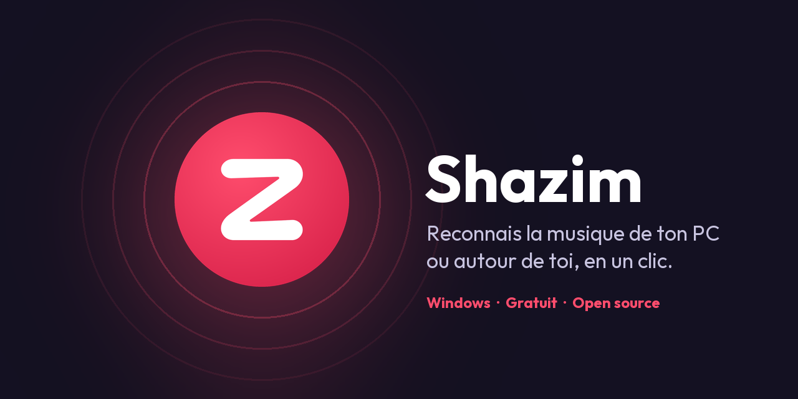
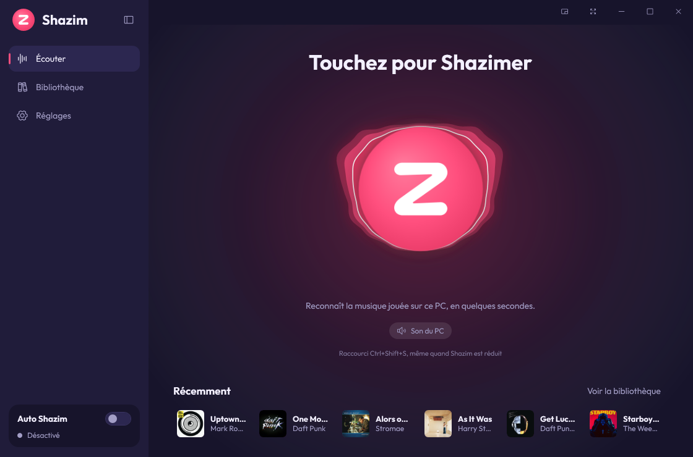
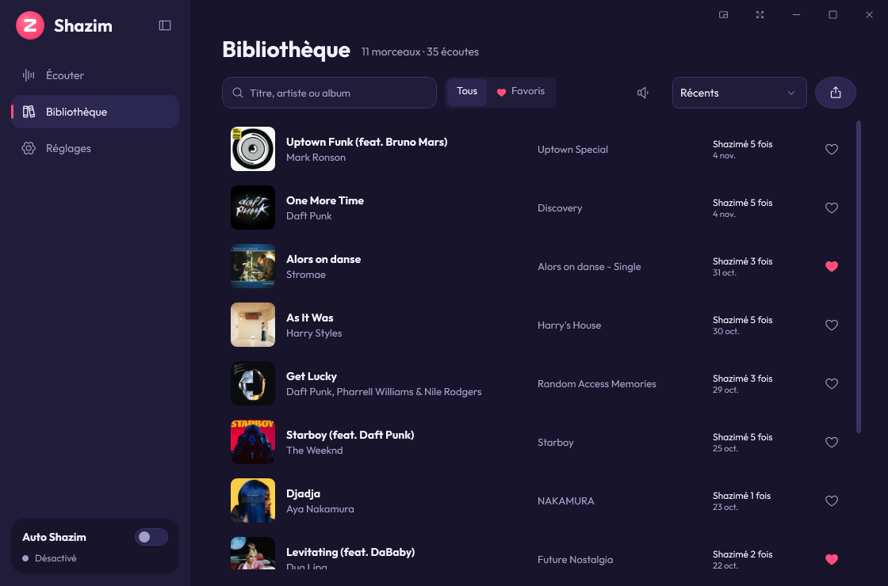
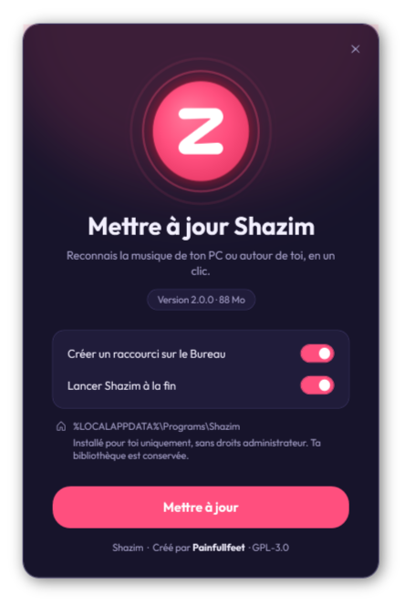

<div align="center">



# Shazim

**Reconoce la música que suena en tu PC o a tu alrededor, con un clic.**<br>
Aplicación gratuita y de código abierto para Windows que identifica cualquier canción: vídeo de YouTube, stream de Twitch, juego, Discord, película, radio… o la música de la habitación con tu micrófono.

[](https://github.com/painfullfeet/Shazim/releases/latest)
[](https://github.com/painfullfeet/Shazim/releases)


[](LICENSE)


[Français](README.md) · [English](README.en.md) · **Español** · [Deutsch](README.de.md)

</div>

---

<p align="center">
  
  
</p>

## ¿Por qué Shazim?

En el móvil basta con abrir Shazam. En el PC es más difícil: la música suena en tus auriculares y el móvil no la oye.
**Shazim escucha directamente el sonido de tu ordenador** (sin micrófono, sin cable) y te da el título en segundos.
También puede usar el micrófono para reconocer la música de la habitación, o ambos a la vez.

- ✅ Gratis, sin anuncios, sin cuenta, sin clave API
- ✅ Instalación en un clic, **sin permisos de administrador**
- ✅ El audio nunca sale de tu PC: solo se envía una huella
- ✅ Interfaz oscura y animada, 5 colores, 4 idiomas

## Funciones

| | |
|---|---|
| 🎧 **Sonido del PC, micrófono o ambos** | Capta lo que oyes (WASAPI loopback), el micrófono (también el de los auriculares) o ambos en paralelo. |
| ⚡ **Rápido** | La búsqueda empieza a los 4 s y sigue (8 s, 12 s) hasta encontrar algo. |
| 💿 **Ficha completa** | Portada, álbum, año, género, sello, avance de 30 s, plataformas (Spotify, Apple Music, Deezer, YouTube Music), veces shazimeada e historial. |
| 📚 **Biblioteca** | Todas tus canciones, búsqueda, favoritos, orden, avances en la lista, exportación CSV o JSON. |
| 🔁 **Auto Shazim** | Escucha sin parar en segundo plano y guarda cada canción nueva. |
| 🌊 **Botón vivo** | El botón reacciona a la música: aura tipo visualizador o pulso del logo al ritmo. |
| 🎨 **Personalizable** | 5 colores, barra lateral plegable, pantalla completa, minirreproductor. |
| 🌍 **4 idiomas** | Français, English, Español, Deutsch — cambio instantáneo. |

## Instalación

1. Ve a **[Releases](https://github.com/painfullfeet/Shazim/releases/latest)** y descarga `Shazim-Setup-x.y.z.exe` (unos 90 MB, .NET incluido).
2. Haz doble clic, elige tus opciones y pulsa **Instalar**.

<p align="center">
  
</p>

> [!NOTE]
> **¿Windows muestra «Windows protegió su PC»?** Es normal en software gratuito sin certificado de firma de pago.
> Pulsa **Más información** y luego **Ejecutar de todas formas**. El código es público y puedes comprobar el archivo con la suma SHA-256 de la release.

Shazim se instala **solo para tu cuenta de Windows** en `%LOCALAPPDATA%\Programs\Shazim`.
**Actualizar**: ejecuta la nueva versión, tu biblioteca se conserva.
**Desinstalar**: Configuración de Windows → Aplicaciones → Aplicaciones instaladas → Shazim.

## Guía rápida

1. Pon la música (vídeo, juego, stream, Spotify…).
2. En Shazim, toca el **botón grande** de la pantalla *Escuchar* (o pulsa `Espacio`).
3. En unos segundos aparece la ficha de la canción, guardada en tu biblioteca.

Aunque Shazim esté minimizado, pulsa **`Ctrl+Mayús+S`** desde cualquier aplicación.

- **Fuente**: *Sonido del PC*, *Micrófono* o *Ambos* (debajo del botón o en **Ajustes**). El botón **Probar** comprueba que llega sonido.
- **Biblioteca**: clic en una canción para ver su ficha; ▶ escucha el avance; ❤ añade a favoritos; exporta en CSV o JSON.
- **Auto Shazim** (`Ctrl+Mayús+A`): escucha continua, ignora duplicados durante un tiempo ajustable.
- **Ajustes**: idioma, efecto del botón (*Aura*, *Pulso*, *Ninguno*), color, inicio con Windows, atajos, notificaciones.

| Atajo | Acción |
|---|---|
| `Ctrl+Mayús+S` | Shazimear (en todo Windows) |
| `Ctrl+Mayús+A` | Activar / desactivar Auto Shazim |
| `Ctrl+1` · `Ctrl+2` · `Ctrl+3` | Escuchar · Biblioteca · Ajustes |
| `Ctrl+B` · `F11` | Barra lateral · Pantalla completa |

## Privacidad

El audio se guarda **solo en memoria** durante la escucha y luego se borra: nada se escribe en el disco. Solo se envía una **huella espectral** calculada en tu PC, nunca el sonido. Sin cuenta, sin anuncios, sin estadísticas. Tus datos están en `%LOCALAPPDATA%\Shazim`.

## Preguntas frecuentes

- **«No se detecta sonido»**: comprueba que la música suena y elige la **salida de audio** correcta en Ajustes, luego **Probar**.
- **«Canción no encontrada»**: prueba en el estribillo o una parte más reconocible.
- **¿Necesito cuenta o clave API?** No.
- **¿Funciona sin conexión?** No, el reconocimiento necesita Internet.

## Compilar

Requisitos: Windows 10/11 y el [SDK de .NET 8](https://dotnet.microsoft.com/download/dotnet/8.0).

```powershell
git clone https://github.com/painfullfeet/Shazim.git
cd Shazim
./run.ps1          # compila y ejecuta
./release.ps1      # crea dist\Shazim-Setup-<versión>.exe
```

## Créditos y licencias

Creado por **Painfullfeet**, con la ayuda de **[Claude](https://claude.ai)**, el asistente de IA de Anthropic.

Algoritmo de firma: portado de [SongRec](https://github.com/marin-m/SongRec) (GPL-3.0) · Audio: [NAudio](https://github.com/naudio/NAudio) (MIT) · Fuente: [Outfit](https://github.com/Outfitio/Outfit-Fonts) (SIL OFL) · Iconos: [Phosphor](https://phosphoricons.com) (MIT).

Shazim es software libre bajo la licencia **[GNU GPL v3](LICENSE)**.

> [!IMPORTANT]
> Shazim es un proyecto personal e independiente, **no afiliado ni respaldado por Shazam ni Apple Inc.** «Shazam» es una marca de Apple Inc. Shazim usa un servicio de reconocimiento no documentado que puede cambiar o dejar de funcionar en cualquier momento.

<div align="center">
<sub>Palabras clave: reconocer música en el PC · identificar canciones en Windows · Shazam para PC · qué canción es esta · reconocimiento de audio</sub>
</div>
