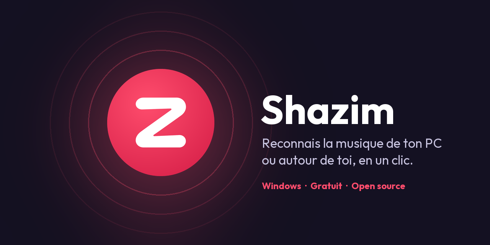
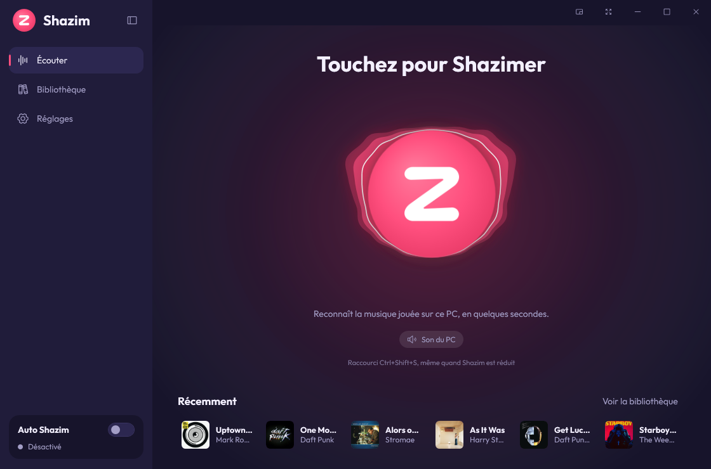
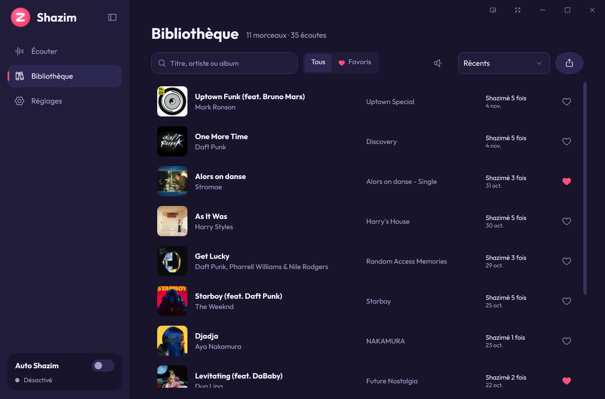
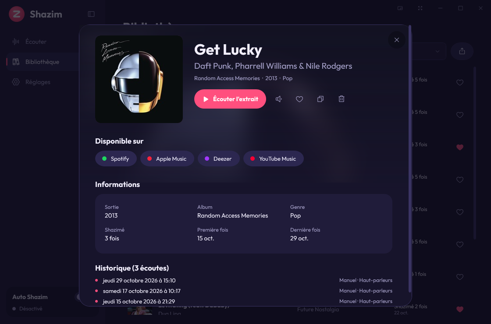
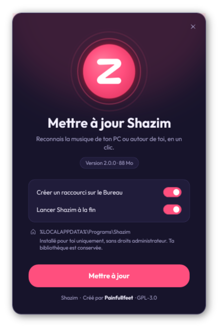
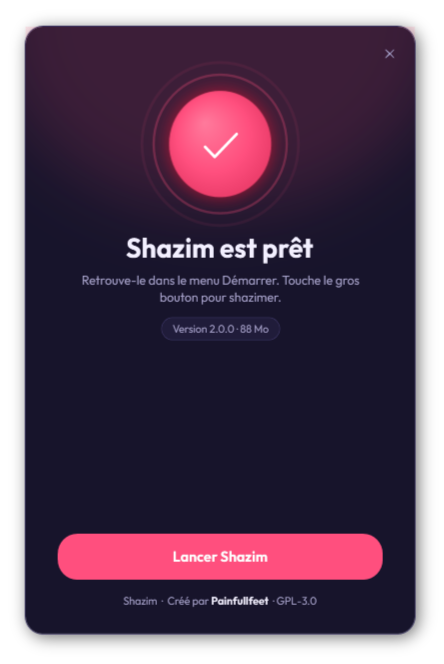
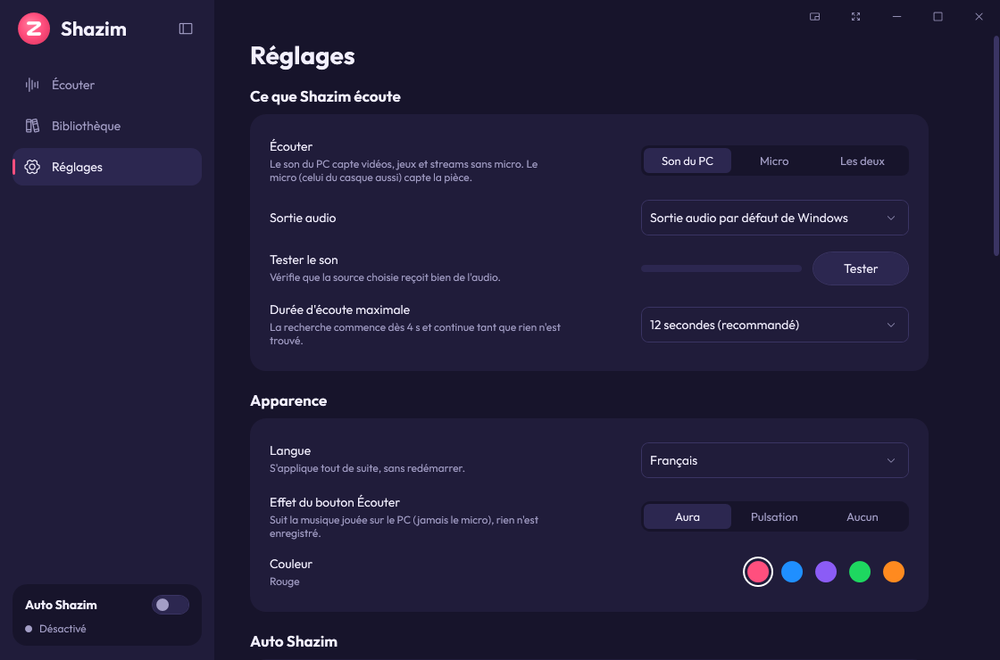

<div align="center">



# Shazim

**Reconnais la musique jouée sur ton PC ou autour de toi, en un clic.**<br>
Application Windows gratuite et open source pour identifier une chanson : vidéo YouTube, stream Twitch, jeu, Discord, film, radio… ou la musique de la pièce via ton micro.

[](https://github.com/painfullfeet/Shazim/releases/latest)
[](https://github.com/painfullfeet/Shazim/releases)


[](LICENSE)


**Français** · [English](README.en.md) · [Español](README.es.md) · [Deutsch](README.de.md)

</div>

---

<p align="center">
  
  
</p>

## Sommaire

- [Pourquoi Shazim ?](#pourquoi-shazim-)
- [Fonctionnalités](#fonctionnalités)
- [Installation](#installation)
- [Guide d'utilisation](#guide-dutilisation)
- [Raccourcis clavier](#raccourcis-clavier)
- [Confidentialité](#confidentialité)
- [Questions fréquentes](#questions-fréquentes)
- [Compiler depuis les sources](#compiler-depuis-les-sources)
- [Crédits et licences](#crédits-et-licences)

## Pourquoi Shazim ?

Sur téléphone, il suffit d'ouvrir Shazam. Sur PC, c'est plus compliqué : la musique sort du casque, le téléphone ne l'entend pas.
**Shazim écoute directement le son de ton ordinateur** (sans micro, sans câble) et te donne le titre en quelques secondes.
Il peut aussi utiliser ton micro pour reconnaître la musique de la pièce, ou les deux en même temps.

- ✅ Gratuit, sans pub, sans compte, sans clé API
- ✅ Installation en un clic, **sans droits administrateur**
- ✅ L'audio ne quitte jamais ton PC : seule une empreinte est envoyée
- ✅ Interface sombre et animée, 5 couleurs, 4 langues

## Fonctionnalités

| | |
|---|---|
| 🎧 **Son du PC, micro ou les deux** | Capte ce que tu entends (WASAPI loopback), le micro (casque compris) ou les deux en parallèle : la première source qui reconnaît le morceau l'emporte. |
| ⚡ **Résultat rapide** | La recherche commence après 4 s d'écoute et continue (8 s, 12 s) tant que rien n'est trouvé. |
| 💿 **Fiche complète** | Pochette, album, année, genre, label, extrait de 30 s, plateformes où l'écouter (Spotify, Apple Music, Deezer, YouTube Music), nombre de fois shazimé et historique. |
| 📚 **Bibliothèque** | Tous tes morceaux, recherche, favoris, tris, écoute des extraits dans la liste, export CSV ou JSON. |
| 🔁 **Auto Shazim** | Écoute en continu en arrière-plan et note chaque nouveau morceau (idéal pour une playlist, un live ou un mix). |
| 🌊 **Bouton vivant** | Le bouton d'écoute réagit à la musique : aura façon visualiseur ou pulsation du logo au rythme. |
| 🎨 **Personnalisable** | 5 couleurs d'accent, barre latérale rétractable, plein écran, mini lecteur flottant. |
| 🔔 **Toujours là** | Icône près de l'horloge, notifications Windows, raccourcis globaux, lancement avec Windows. |
| 🌍 **4 langues** | Français, English, Español, Deutsch — changement instantané, sans redémarrer. |

<p align="center">
  
</p>

## Installation

### 1. Télécharger

Va sur la page **[Releases](https://github.com/painfullfeet/Shazim/releases/latest)** et télécharge `Shazim-Setup-x.y.z.exe` (environ 90 Mo, rien d'autre à installer : .NET est inclus).

### 2. Lancer l'installateur

Double-clique sur le fichier téléchargé, choisis tes options puis clique sur **Installer**.

<p align="center">
  
  &nbsp;&nbsp;
  
</p>

> [!NOTE]
> **Windows affiche « Windows a protégé votre ordinateur » ?** C'est normal pour un logiciel gratuit qui n'a pas de certificat de signature payant.
> Clique sur **Informations complémentaires** puis **Exécuter quand même**. Le code source est entièrement public ici, et tu peux vérifier le fichier avec la somme SHA-256 publiée dans la release.

L'installation se fait **pour ton compte Windows uniquement**, dans `%LOCALAPPDATA%\Programs\Shazim`, avec un raccourci dans le menu Démarrer (et sur le Bureau si tu le souhaites).

### Mettre à jour

Télécharge la nouvelle version et lance-la : elle remplace l'ancienne. **Ta bibliothèque et tes réglages sont conservés.**

### Désinstaller

**Paramètres Windows → Applications → Applications installées → Shazim → Désinstaller.**
Tu peux choisir de garder ou de supprimer ta bibliothèque.

## Guide d'utilisation

### Identifier un morceau

1. Lance la musique (vidéo, jeu, stream, Spotify…).
2. Dans Shazim, touche le **gros bouton** de l'écran *Écouter* (ou appuie sur `Espace`).
3. En quelques secondes, la fiche du morceau s'affiche. Il est automatiquement ajouté à ta bibliothèque.

Même quand Shazim est réduit, appuie sur **`Ctrl+Maj+S`** depuis n'importe quelle application.

### Choisir ce que Shazim écoute

Sous le bouton, ou dans **Réglages → Ce que Shazim écoute** :

- **Son du PC** : tout ce qui sort de tes haut-parleurs ou de ton casque. Aucun micro nécessaire.
- **Micro** : la musique dans la pièce (enceinte, soirée, magasin…). Le micro du casque marche aussi.
- **Les deux** : les deux sources sont analysées en même temps.

Le bouton **Tester** des réglages vérifie que la source choisie reçoit bien du son.

### La bibliothèque

- Clique sur un morceau pour ouvrir sa fiche : extrait, plateformes, informations, historique d'écoute.
- ▶ écoute l'extrait directement dans la liste ; l'icône 🔊 règle son volume.
- ❤ ajoute aux favoris ; le filtre **Favoris** n'affiche qu'eux.
- Le bouton d'export enregistre ta bibliothèque en **CSV** (Excel) ou **JSON**.

### Auto Shazim

Active l'interrupteur **Auto Shazim** dans la barre latérale : Shazim écoute en boucle et enregistre chaque nouveau morceau, même fenêtre fermée. Les doublons sont ignorés pendant un délai réglable (15 min par défaut). Raccourci : **`Ctrl+Maj+A`**.

### Réglages utiles

<p align="center">
  
</p>

- **Langue** : Français, English, Español, Deutsch.
- **Effet du bouton** : *Aura* (vagues qui suivent la musique), *Pulsation* (le logo bat au rythme) ou *Aucun*.
- **Couleur** : rouge, bleu, violet, vert ou orange.
- **Démarrage** : lancer avec Windows, rester dans la zone de notification, fermer la fenêtre sans quitter.
- **Raccourcis globaux** et **notifications** personnalisables.

## Raccourcis clavier

| Raccourci | Action |
|---|---|
| `Ctrl+Maj+S` | Shazimer (partout dans Windows) |
| `Ctrl+Maj+A` | Activer / couper Auto Shazim (partout dans Windows) |
| `Espace` | Shazimer / écouter l'extrait sélectionné |
| `Ctrl+1` · `Ctrl+2` · `Ctrl+3` | Écouter · Bibliothèque · Réglages |
| `Ctrl+B` | Réduire / agrandir la barre latérale |
| `F11` | Plein écran |
| `Entrée` | Ouvrir le morceau sélectionné |
| `Échap` | Fermer la fiche / revenir |

## Confidentialité

- L'audio est gardé **en mémoire** le temps de l'écoute (12 s au plus) puis effacé : **rien n'est enregistré sur le disque**.
- Seule une **empreinte spectrale** calculée sur ton PC est envoyée au service de reconnaissance, jamais le son.
- Pas de compte, pas de publicité, pas de statistiques d'utilisation.
- Tes données restent chez toi, dans `%LOCALAPPDATA%\Shazim` : bibliothèque (`shazim.db`), réglages, pochettes en cache, journal.

## Questions fréquentes

<details>
<summary><b>« Aucun son détecté » : que faire ?</b></summary>

Vérifie que la musique joue vraiment et pas en sourdine. Dans **Réglages**, choisis la bonne **sortie audio** (celle de ton casque si tu en utilises un) puis clique sur **Tester**.
</details>

<details>
<summary><b>« Morceau introuvable »</b></summary>

Réessaie pendant un passage plus caractéristique (refrain, mélodie). Les remix très rares, les morceaux très récents ou les passages parlés sont parfois inconnus. Le micro marche moins bien s'il y a beaucoup de bruit autour.
</details>

<details>
<summary><b>Faut-il un compte Shazam ou une clé API ?</b></summary>

Non. Shazim fonctionne sans compte et sans clé.
</details>

<details>
<summary><b>Mon antivirus ou SmartScreen bloque le fichier</b></summary>

Le fichier n'est pas signé avec un certificat payant, ce qui déclenche parfois un avertissement. Le code est public ; tu peux vérifier l'empreinte SHA-256 indiquée dans la release (`Get-FileHash .\Shazim-Setup-2.0.0.exe`) ou compiler toi-même l'application.
</details>

<details>
<summary><b>Est-ce que ça marche hors ligne ?</b></summary>

Non : la reconnaissance a besoin d'Internet. La bibliothèque, elle, reste consultable hors ligne.
</details>

<details>
<summary><b>Où sont mes données ? Comment tout effacer ?</b></summary>

Dans `%LOCALAPPDATA%\Shazim` (bouton **Ouvrir le dossier des données** dans les réglages). À la désinstallation, coche « Supprimer aussi ma bibliothèque et mes réglages ».
</details>

<details>
<summary><b>Shazim existe-t-il sur Mac ou Linux ?</b></summary>

Non, Shazim est une application Windows (10 et 11, 64 bits). Sous Linux, le projet [SongRec](https://github.com/marin-m/SongRec) dont s'inspire la reconnaissance est une excellente alternative.
</details>

## Compiler depuis les sources

Prérequis : Windows 10/11 et le [SDK .NET 8](https://dotnet.microsoft.com/download/dotnet/8.0).

```powershell
git clone https://github.com/painfullfeet/Shazim.git
cd Shazim
./build.ps1        # compile
./run.ps1          # compile et lance
./test.ps1         # tests unitaires
./release.ps1      # produit dist\Shazim-Setup-<version>.exe (un seul fichier)
./install.ps1      # ouvre l'installateur produit
```

L'architecture du code est décrite dans [ARCHITECTURE.md](ARCHITECTURE.md). Les contributions et les signalements de bugs sont les bienvenus dans les [Issues](https://github.com/painfullfeet/Shazim/issues).

<a id="licences"></a>

## Crédits et licences

Créé par **Painfullfeet**, avec l'aide de **[Claude](https://claude.ai)**, l'assistant IA d'Anthropic.

| Élément | Source | Licence |
|---|---|---|
| Algorithme de signature audio | Portage C# de [SongRec](https://github.com/marin-m/SongRec) (marin-m) | GPL-3.0 |
| Capture et lecture audio | [NAudio](https://github.com/naudio/NAudio) | MIT |
| Base de données | [Microsoft.Data.Sqlite](https://github.com/dotnet/efcore) | MIT |
| Police | [Outfit](https://github.com/Outfitio/Outfit-Fonts) | [SIL OFL 1.1](assets/licenses/Outfit-OFL.txt) |
| Icônes | [Phosphor Icons](https://phosphoricons.com) | [MIT](assets/licenses/Phosphor-MIT.txt) |
| Inspiration design | [ui-ux-pro-max-skill](https://github.com/nextlevelbuilder/ui-ux-pro-max-skill) | — |
| Métadonnées et extraits | Service de reconnaissance Shazam | — |

Shazim est un logiciel libre distribué sous licence **[GNU GPL v3](LICENSE)**.

> [!IMPORTANT]
> Shazim est un projet personnel et indépendant. Il **n'est ni affilié, ni approuvé, ni soutenu par Shazam ou Apple Inc.**
> « Shazam » est une marque d'Apple Inc. Shazim utilise un service de reconnaissance non documenté qui peut changer ou cesser de fonctionner à tout moment.
> Les pochettes, titres et extraits appartiennent à leurs ayants droit.

---

<div align="center">
<sub>Mots-clés : reconnaissance musicale PC · identifier une chanson sur Windows · Shazam pour PC · trouver le titre d'une musique · audio fingerprinting · music recognition Windows · song identifier desktop</sub>
<br><br>
<sub>Fait avec ❤ par Painfullfeet · Si Shazim t'est utile, laisse une ⭐ !</sub>
</div>
